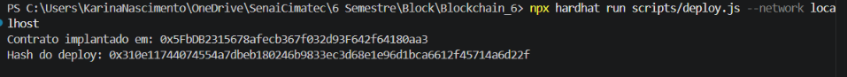
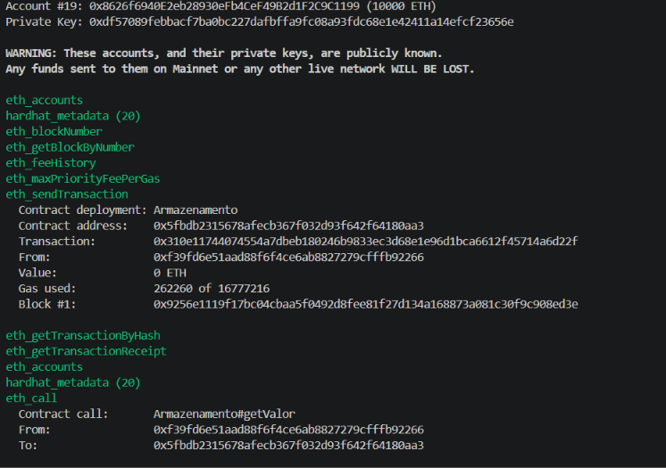
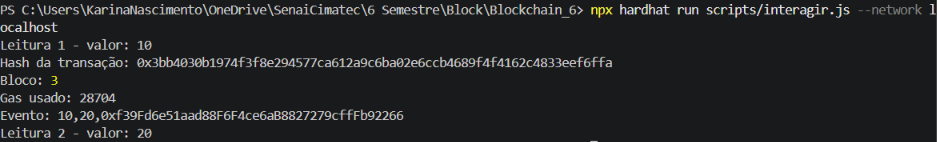
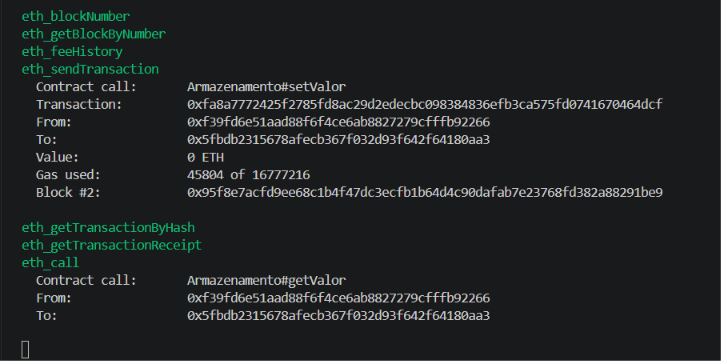

# DApp Armazenamento: Hardhat + Ethers.js

Atividade prática do ciclo de vida de um DApp numa rede local. O contrato é escrito em Solidity, compilado e implantado com o Hardhat, e depois um script com Ethers.js lê e altera o estado dele.

## Estrutura

| Arquivo | Função |
|---|---|
| [contracts/Armazenamento.sol](contracts/Armazenamento.sol) | Contrato: guarda um `uint`, tem leitura (`getValor`), escrita (`setValor`) e emite o evento `ValorAlterado` |
| [scripts/deploy.js](scripts/deploy.js) | Implanta o contrato e grava o endereço em `endereco.txt` |
| [scripts/interagir.js](scripts/interagir.js) | Lê o valor, soma 10 (transação), mostra hash, bloco, gas e evento, e lê de novo |
| [hardhat.config.js](hardhat.config.js) | Configuração do Hardhat (Solidity 0.8.24) |
| [endereco.txt](endereco.txt) | Endereço do contrato implantado |
| [evidencias/](evidencias/) | Capturas de tela da execução |

## Como executar

Pré-requisito: Node.js instalado.

```bash
npm install
npx hardhat compile
```

Em um **segundo terminal**, deixe a blockchain local rodando:

```bash
npx hardhat node
```

No primeiro terminal:

```bash
npx hardhat run scripts/deploy.js --network localhost
npx hardhat run scripts/interagir.js --network localhost
```

Atalhos equivalentes: `npm run compile`, `npm run node`, `npm run deploy` e `npm run interagir`.

> A rede do `npx hardhat node` fica só na memória. Se ela for reiniciada, é preciso rodar o deploy de novo.

## O contrato

```solidity
function getValor() public view returns (uint)   // leitura: não cria transação
function setValor(uint novo) public              // escrita: cria transação e emite ValorAlterado(antigo, novo, quem)
```

`setValor` recusa um valor igual ao atual (`require`), e o construtor grava em `dono` quem implantou o contrato.

## Evidências da execução

### Deploy

| Item | Valor |
|---|---|
| Contrato | `Armazenamento` |
| Endereço | `0x5FbDB2315678afecb367f032d93F642f64180aa3` |
| Hash da transação | `0x310e11744074554a7dbeb180246b9833ec3d68e1e96d1bca6612f45714a6d22f` |
| Conta que implantou | `0xf39fd6e51aad88f6f4ce6ab8827279cfffb92266` (Account #0) |
| Gas usado | 262260 |
| Bloco | #1 |




### Leitura → escrita → nova leitura

Saída do `scripts/interagir.js`:

```
Leitura 1 - valor: 10
Hash da transação: 0x3bb4030b1974f3f8e294577ca612a9c6ba02e6ccb4689f4f4162c4833eef6ffa
Bloco: 3
Gas usado: 28704
Evento: 10,20,0xf39Fd6e51aad88F6F4ce6aB8827279cfFFb92266
Leitura 2 - valor: 20
```



| Etapa | Chamada | Resultado |
|---|---|---|
| Leitura 1 | `getValor` (`eth_call`) | `10`, sem transação nem gas |
| Escrita | `setValor(20)` (`eth_sendTransaction`) | Hash `0x3bb4030b...6ffa`, bloco #3, gas 28704 |
| Evento | `ValorAlterado` | antigo = 10, novo = 20, quem = Account #0 |
| Leitura 2 | `getValor` (`eth_call`) | `20`: o estado foi atualizado |

Antes desta execução, uma escrita anterior tinha alterado o valor de 0 para 10 no bloco #2, gastando 45804 de gas. O log do node mostra essa escrita:



**Por que o gas foi diferente?** A escrita 0 → 10 gastou 45804 de gas, e a 10 → 20 gastou 28704. Gravar um valor diferente de zero num slot de armazenamento que estava zerado é mais caro (SSTORE de 20000 gas) do que alterar um valor que já era diferente de zero (cerca de 2900 gas).

### Contas da rede local

Quando sobe, o `npx hardhat node` cria 20 contas de teste com 10000 ETH cada ([1](evidencias/01-contas-node-1.png), [2](evidencias/02-contas-node-2.png)). Essas contas e chaves privadas são **públicas e iguais em qualquer instalação do Hardhat**. Elas servem só para teste e nunca devem receber fundos reais.

## Análise do ciclo de vida

O **Hardhat** compilou o contrato Solidity em bytecode e ABI (pasta `artifacts`) e simulou uma blockchain local, a Hardhat Network, sem custo real de gas. O **script de deploy** enviou a transação de implantação, que foi minerada no bloco 1, e salvou o endereço do contrato. O **script de interação** usou o **Ethers.js** para criar a instância do contrato a partir de **endereço + ABI + carteira**. A leitura (`getValor`) foi uma `eth_call`, que não gera transação nem gasta gas, e retornou 10. A escrita (`setValor`) gerou uma transação minerada no bloco 3, consumiu 28704 de gas e emitiu o evento `ValorAlterado(10, 20, Account #0)`. A segunda leitura retornou 20, o que confirma que o estado foi atualizado.

### Checklist

- [x] Compilação
- [x] Deploy (endereço registrado)
- [x] Leitura
- [x] Escrita (transação confirmada)
- [x] Atualização de estado (nova leitura)

## Possíveis extensões

- Restringir `setValor` ao `dono` (`require(msg.sender == dono)`).
- Escrever testes automatizados com `npx hardhat test` (Mocha/Chai).
- Escutar o evento `ValorAlterado` em tempo real com `contrato.on(...)`.
- Criar uma interface web com MetaMask.
- Implantar numa testnet pública, como a Sepolia.
